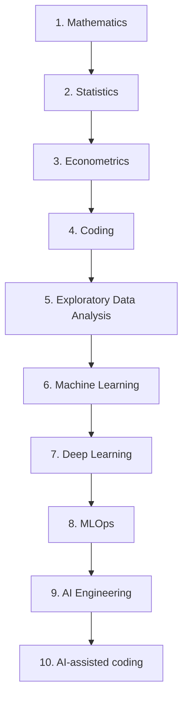

# AI & Data Scientist Study Roadmap

[](https://arnold-rg.github.io/ai-data-scientist-roadmap/)
[](https://arnold-rg.github.io/ai-data-scientist-roadmap/)
[](./.github/workflows/study-checks.yml)
[](./stages)
[](./quizzes)
[](./projects)
[](./LICENSE)

A full **study curriculum** for becoming an AI and Data Scientist — lessons, quizzes, checkpoint tests, interview drills, and portfolio projects.

**Use it in the browser:** [https://arnold-rg.github.io/ai-data-scientist-roadmap/](https://arnold-rg.github.io/ai-data-scientist-roadmap/)

This repository follows the official topic order on [roadmap.sh/ai-data-scientist](https://roadmap.sh/ai-data-scientist) and expands every node into something you can actually **learn, test, and build**.

> Study-only resource. Work through it at your own pace. The goal is understanding, not rushing a certificate.

<p align="center">
  <a href="#the-10-stage-path">Stages</a> ·
  <a href="#how-to-use-this-repo">How to use</a> ·
  <a href="#quizzes-and-tests">Quizzes</a> ·
  <a href="#projects">Projects</a> ·
  <a href="STUDY_PLAN.md">Study plans</a> ·
  <a href="docs/00-what-is-a-data-scientist.md">What is a data scientist?</a>
</p>

---

## Why this repo exists

roadmap.sh gives you the **map**. This repo is the **course**:

| You get | Where |
| --- | --- |
| Clear explanations of every major topic | [`stages/`](./stages) |
| Role, career, lifecycle, and skills guides | [`docs/`](./docs) |
| Graded quizzes (including a final exam) | [`quizzes/`](./quizzes) |
| Python checkpoint tests | [`tests/`](./tests) and [`exercises/`](./exercises) |
| Ten original projects with synthetic data | [`projects/`](./projects) |
| Interview questions and take-home cases | [`interview/`](./interview) |
| 12-week and 24-week calendars | [`STUDY_PLAN.md`](./STUDY_PLAN.md) |

The official path is a sequence of ten capabilities. Each one unlocks the next:



That order is not fashion. Models are linear algebra plus calculus. Experiments are statistics. Causal claims need econometric thinking. Code is how those ideas touch data. EDA is how you refuse to model garbage. Machine learning turns patterns into predictions. Deep learning scales that to unstructured data. MLOps is how a model survives contact with production. AI engineering is how large language models become systems. AI-assisted coding is how modern practitioners ship the work.

---

## The 10-stage path

Aligned to [roadmap.sh/ai-data-scientist](https://roadmap.sh/ai-data-scientist).

| # | Stage | What you actually learn | Quiz | Project |
| --- | --- | --- | --- | --- |
| 01 | [Mathematics](stages/01-mathematics) | Linear algebra, calculus, analysis for models | `python quizzes/run_quiz.py --stage 01` | — |
| 02 | [Statistics](stages/02-statistics) | CLT, hypothesis tests, sampling, A/B tests, sensitivity | `--stage 02` | [03 A/B test](projects/03-ab-test) |
| 03 | [Econometrics](stages/03-econometrics) | Regression, identification, time series | `--stage 03` | [05 Time series](projects/05-time-series) |
| 04 | [Coding](stages/04-coding) | Python, DSA for interviews, SQL | `--stage 04` | — |
| 05 | [EDA](stages/05-eda) | Data sense, cleaning, visualization | `--stage 05` | [01 Retail EDA](projects/01-eda-retail) |
| 06 | [Machine Learning](stages/06-machine-learning) | Supervised, unsupervised, ensembles | `--stage 06` | [02 Houses](projects/02-house-prices) · [04 Segments](projects/04-customer-segments) |
| 07 | [Deep Learning](stages/07-deep-learning) | Dense nets, CNN, RNN/LSTM, transformers | `--stage 07` | [06 Sentiment](projects/06-sentiment) · [07 Shapes](projects/07-image-shapes) |
| 08 | [MLOps](stages/08-mlops) | Deployment, CI/CD, monitoring | `--stage 08` | [09 Model API](projects/09-model-api) |
| 09 | [AI Engineering](stages/09-ai-engineering) | Prompts, LLMs, RAG, agents, fine-tuning | `--stage 09` | [08 RAG-lite](projects/08-rag-lite) |
| 10 | [AI-assisted coding](stages/10-vibe-coding) | Assistants and app builders, used carefully | `--stage 10` | [10 Capstone](projects/10-capstone) |

Final exam: `python quizzes/run_quiz.py --exam`

---

## How to use this repo

1. Read [HOW_TO_STUDY.md](HOW_TO_STUDY.md).
2. Pick a calendar in [STUDY_PLAN.md](STUDY_PLAN.md) (12 weeks focused, 24 weeks thorough).
3. For each stage: **lesson → exercises → quiz → project**.
4. Track yourself in [progress/tracker.md](progress/tracker.md).
5. Before interviews, run `python quizzes/run_quiz.py --interview` and work through [`interview/`](./interview).

### Study in the browser (live)

Open the public atlas:

**[https://arnold-rg.github.io/ai-data-scientist-roadmap/](https://arnold-rg.github.io/ai-data-scientist-roadmap/)**

Search (Ctrl/Cmd+K), read lessons, take quizzes, follow the 12-week plan, and track progress in the browser. To run the same site locally:

```bash
python web/serve.py
```

### Setup (quizzes from the terminal + projects)

```bash
python -m venv .venv
# Windows
.venv\Scripts\activate
# macOS / Linux
source .venv/bin/activate

python -m pip install -r requirements.txt
```

### Daily loop

```bash
# 1. Read a lesson in stages/
# 2. Run the matching checkpoint
pytest tests/test_stage_01_math.py

# 3. Take the quiz
python quizzes/run_quiz.py --stage 01

# 4. Build the matching project
python projects/01-eda-retail/analyze.py
```

You pass a stage when:

- the lesson checklists make sense without looking
- `pytest` for that stage is green
- the quiz is at or above 70%
- the project README “done when” box is complete

---

## Quizzes and tests

There are **twelve quiz banks**: ten stage quizzes, a mixed final exam, and interview warmups.

```bash
python quizzes/run_quiz.py              # interactive menu
python quizzes/run_quiz.py --stage 06
python quizzes/run_quiz.py --exam
python quizzes/run_quiz.py --interview
python quizzes/run_quiz.py --validate
pytest
```

Checkpoint tests live in [`tests/`](./tests) and exercise implementations live in [`exercises/`](./exercises). The implementations are **worked solutions** — read them, then hide them and rewrite from memory.

---

## Projects

All datasets are **synthetic and generated in this repo**. Nothing is scraped. Nothing needs an API key.

| Project | Level | Skills |
| --- | --- | --- |
| [Retail EDA](projects/01-eda-retail) | Beginner | Pandas, visualization, data quality |
| [House prices](projects/02-house-prices) | Beginner | Regression, features, holdout metrics |
| [A/B test](projects/03-ab-test) | Intermediate | Experiment design, inference |
| [Customer segments](projects/04-customer-segments) | Intermediate | Clustering, silhouette, PCA thinking |
| [Time series](projects/05-time-series) | Intermediate | Seasonality, baselines, forecast error |
| [Sentiment](projects/06-sentiment) | Intermediate | Text, TF-IDF, classification |
| [Image shapes](projects/07-image-shapes) | Intermediate | Features from pixels, evaluation |
| [RAG-lite](projects/08-rag-lite) | Advanced | Retrieval, grounding, LLM systems without a paid API |
| [Model API](projects/09-model-api) | Advanced | Serialization, prediction interface, tests |
| [Churn capstone](projects/10-capstone) | Advanced | End-to-end: EDA, model, written decision |

Details: [projects/README.md](projects/README.md)

---

## What a data scientist actually does

A data scientist turns messy evidence into a decision someone else can trust.

That usually means four jobs, in a loop:

1. **Collect** — logs, tables, surveys, text, images.
2. **Clean** — missingness, leakage, units, outliers that are bugs vs. outliers that are the story.
3. **Analyze** — plots, statistics, models. The model is optional; the question is not.
4. **Share** — a number, a chart, a recommendation, and the conditions under which it stops being true.

If you want the long version: [docs/00-what-is-a-data-scientist.md](docs/00-what-is-a-data-scientist.md).

Related guides:

- [Data science lifecycle](docs/lifecycle.md)
- [Skills map](docs/skills.md)
- [How this role differs from neighboring jobs](docs/roles-compared.md)
- [Career notes](docs/career.md)
- [Tools](docs/tools.md)

---

## Source

Topic sequence and high-level nodes follow the community roadmap:

**[https://roadmap.sh/ai-data-scientist](https://roadmap.sh/ai-data-scientist)**

Lessons, quizzes, tests, and projects in this repository are original study material written for learning. They are not a copy of roadmap.sh course text.

Related roadmaps when you finish: [Python](https://roadmap.sh/python) · [Data Analyst](https://roadmap.sh/data-analyst) · [AI Engineer](https://roadmap.sh/ai-engineer) · [Prompt Engineering](https://roadmap.sh/prompt-engineering)

---

## Author

Arnold Rurangwa · ARNOVA Group · Computer Engineer

---

## License

MIT. See [LICENSE](./LICENSE).
